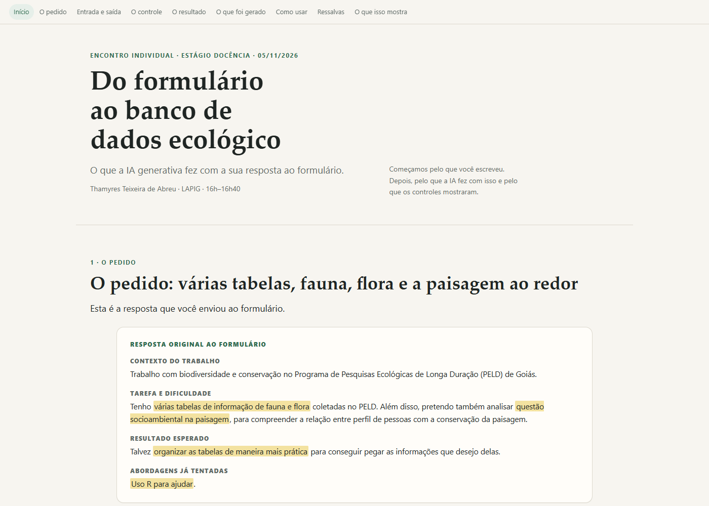

# Do formulário ao banco de dados ecológico — PELD Goiás

**Um kit em R que lê as planilhas de fauna e flora pelo dicionário de colunas, faz point-in-polygon, monta um banco SQLite e uma tabela de análise — com os limites de amostra, escala e perfil de pessoas explícitos.**

Encontro individual do Estágio Docência · LAPIG/UFG · 05/11/2026.

- **Ver a página:** <https://victorgit10.github.io/thamyres-peld/>
- **Repositório:** <https://github.com/VictorGit10/thamyres-peld>



## O que tem aqui

- **`index.html`**: a página do encontro. Começa pela resposta ao formulário e mostra o que a IA generativa fez com ela: a entrada, a primeira saída, os controles, o resultado e o que isso mostra. Funciona offline (imagens embutidas).
- **O pacote** (`codigo/`, `dados/`, `figuras/`, `RELATORIO.md`, `REFERENCIAS.md`): o trabalho completo, executado de ponta a ponta. Todos os números saem dos scripts. Instruções abaixo.
- **`CLAUDE.md` e `AGENTS.md`**: o contexto para a IA que for continuar o trabalho.
- **`docs/revisoes/`**: o caminho do trabalho, para quem quiser auditar: o formulário (`CONTEXTO.md`), o pedido dado ao agente (`PEDIDO.md`, `REGRAS-COMUNS.md`), as correções pedidas (`CORRECOES*.md`) e a conferência independente de outro modelo (`REVISAO-MINIMAX.md`).

## Como foi feito

1. O formulário virou um pedido escrito para um agente de IA (Gemini 3.8 Flash, no agy), com regras: dados públicos, todo número saindo de script, controle em cada conclusão, referência só com DOI conferido.
2. O agente executou o kit; Claude conferiu os números, o SQLite, os testes e os DOIs, e pediu correções.
3. A revisão de três passadas (Gemini, contextos novos) e um subagente MiniMax 3.1 Flash revisaram a página e o pacote sem poder alterar nada; cada achado foi conferido no código antes de corrigir.
4. A página foi escrita e ilustrada para o encontro, com as figuras calculadas dos dados do pacote.

Os brutos do GBIF e as malhas do IBGE estão em `dados/bruto/` para o teste ser reproduzível; os scripts também baixam de novo. O projeto do Earth Engine aparece como `SEU-PROJETO-EARTH-ENGINE`: troque pelo seu.

## Continuar com uma IA

O repositório foi organizado para um assistente ler. Cole o link no Claude, ChatGPT, Gemini ou Codex e peça, por exemplo: "Explique a estrutura deste repositório e como rodar o pacote", ou "Adapte o procedimento para os meus dados". O `CLAUDE.md` traz o contexto, as armadilhas e a ordem dos scripts.

## Licença

Texto, página e figuras: CC BY 4.0. Código em `codigo/`: MIT. Detalhes em `LICENSE`.

---

# O pacote

## Kit em R para Dados Ecológicos de Fauna, Flora e Paisagem — PELD Goiás

Este repositório contém um kit computacional desenvolvido sob medida para a pesquisadora do **Programa de Pesquisas Ecológicas de Longa Duração (PELD) de Goiás**. O objetivo do kit é transformar o caos de planilhas heterogêneas de campo em um **banco de dados relacional análise-pronto (SQLite + CSVs canônicos)** e demonstrar, com dados públicos reais do sudoeste goiano, como conectar ocorrências de biodiversidade a métricas de paisagem (MapBiomas) e indicadores socioeconômicos (IBGE), com controles estritos contra o problema de escala e a falácia ecológica.

**Apresentação do encontro:** [`index.html`](index.html) (arquivo único, offline, com as figuras embutidas).

---

## Estrutura do Repositório

```text
├── codigo/
│   ├── 00_instalar.R          # Verifica e instala os pacotes do R
│   ├── 01_baixar_gbif.R       # Baixa uma AMOSTRA de 3.000 registros do GBIF (1.500 por grupo)
│   ├── 02_baixar_ibge.R       # Baixa malhas municipais, centroides e dados do Censo/PIB (SIDRA)
│   ├── 03_paisagem_gee.py     # Extrai metricas de paisagem no MapBiomas Col. 11 via Earth Engine
│   ├── 03b_atribuir_locais.py # Juncao espacial point-in-polygon contra GeoJSONs municipais (GeoPandas)
│   ├── 04_auditar.R           # Audita inconsistencias orientada a dicionario nas tabelas brutas
│   ├── 05_padronizar.R        # Ingestao dinamica via dicionario, cria banco SQLite e CSVs canonicos
│   ├── 06_juntar.R            # Gera tabela integrada de analise (biodiversidade x paisagem x social)
│   ├── 07_analisar.R          # Analise ecologica, Spearman, controle de escala e controle negativo
│   ├── 08_figuras.R           # Gera os graficos analiticos (300 DPI) e diagrama Mermaid
│   ├── 10_teste_dicionario.R  # Teste automatizado de ingestao de tabela com cabecalhos arbitrarios
│   ├── 10b_teste_fluxo_completo.R # Teste 03b+05+06 com uma tabela customizada em pasta temporaria
│   ├── 11_verificar_numeros.R # Assercoes que conferem os numeros dos relatorios contra os scripts
│   └── 99_rodar_tudo.R        # Script mestre que executa todo o pipeline do zero
├── R/
│   └── funcoes.R              # Motor de dicionario, mapeamento dinamico e funcoes utilitarias
├── dados/
│   ├── bruto/                 # Arquivos brutos baixados (GBIF, IBGE, MapBiomas)
│   ├── banco/                 # CSVs canonicos padronizados e peld.sqlite
│   ├── exemplo/               # Tabela exemplo nao-GBIF (minha_flora.csv) para teste do dicionario
│   └── modelo_perfil_propriedade.csv  # Especificacao de esquema para entrevistas de campo
├── figuras/                   # Graficos em alta resolucao (300 DPI)
├── saidas/
│   ├── diagnostico.md         # Relatorio legivel da auditoria orientada a dicionario
│   ├── problemas.csv          # Lista registro a registro de inconsistencias encontradas
│   ├── resumo_auditoria.csv   # Sumario quantitativo dos problemas por tipo e gravidade
│   ├── resumo_espacializacao.csv # Registros dentro vs fora dos poligonos municipais
│   ├── tabela_analise.csv     # Tabela consolidada analise-pronta (local x unidade agregacao x grupo)
│   ├── tabela_controle_escala.csv  # Comparativo de Spearman entre municipio e buffers locais
│   ├── tabela_riqueza_locais.csv # Riqueza real por municipio e grupo taxonômico
│   ├── esquema.md             # Diagrama de Entidade-Relacionamento do banco em Mermaid
│   └── metricas_analise.json  # Todas as metricas estatisticas calculadas pelos scripts
├── dicionario_colunas.csv     # O MOTOR: Mapeamento declarativo entre planilhas brutas e o banco
├── esquema.sql                # DDL formal do banco SQLite com chaves estrangeiras
├── RELATORIO.md               # Relatorio tecnico e cientifico completo
├── REVISAO-ALVO.md            # As 12 afirmacoes centrais para revisao independente
├── REFERENCIAS.md             # Referencias bibliograficas validadas na API Crossref
├── CORRECOES-REVISAO.md       # Registro detalhado das correcoes aplicadas apos auditoria de 3 passadas
├── CLAUDE.md / AGENTS.md      # Instrucoes tecnicas para agentes de IA continuarem o trabalho
└── ROTEIRO-ENCONTRO.md        # Roteiro de 40 minutos para apresentacao individual
```

---

## Passo a Passo: Como Aplicar nas Suas Próprias Planilhas

Você **não precisa alterar a formatação nem os cabeçalhos das suas planilhas de campo**. O kit utiliza um motor dinâmico de ingestão baseado no [`dicionario_colunas.csv`](dicionario_colunas.csv).

Para verificar como uma tabela com nomes de colunas arbitrários é lida e convertida para o esquema canônico, o repositório já inclui um exemplo real em [`dados/exemplo/minha_flora.csv`](dados/exemplo/minha_flora.csv) (com colunas `Sp_Name`, `Dt_Coleta`, `Qtde`, `Lat`, `Lon`) e um teste unitário automatizado em [`codigo/10_teste_dicionario.R`](codigo/10_teste_dicionario.R).

Siga os 4 passos abaixo para incorporar suas planilhas:

### Passo 1: Coloque suas planilhas na pasta `dados/bruto/`
Copie seus arquivos de fauna e flora (em formato `.csv` ou exportados do Excel) para a pasta `dados/bruto/` (ex.: `dados/bruto/minhas_aves.csv`, `dados/bruto/minha_vegetacao.csv`).

### Passo 2: Adicione o mapeamento no `dicionario_colunas.csv`
Abra o [`dicionario_colunas.csv`](dicionario_colunas.csv) no Excel ou editor de texto e adicione as linhas correspondentes:
- `tabela_destino`: Tabela de destino canônica (`observacao`, `especie`, `campanha`, etc.);
- `campo_destino`: Campo canônico (`grupo`, `especie`, `individuos`, `data`, `lat`, `lon`, `incerteza_metros`);
- `tabela_origem`: Nome do seu arquivo (sem a extensão `.csv`);
- `campo_origem`: Nome exato da coluna na sua planilha (ex.: `Especie_Coletada`, `N_Individuos`, `Data_Obs`);
- `obrigatorio`: `TRUE` para campos essenciais ou `FALSE`.

> Use `grupo` exatamente como `Flora`, `Aves` ou `Mammalia`. Não mapeie `id_local`: o `03b` calcula pelo point-in-polygon. Se preferir, inclua um bloco novo para a sua planilha; não edite as linhas do GBIF nem o bloco `minha_flora`.

### Passo 3: Rode o Teste do Dicionário, a Espacialização e a Auditoria
Abra o terminal e execute:
```powershell
Rscript codigo/10_teste_dicionario.R
Rscript codigo/10b_teste_fluxo_completo.R
python codigo/03b_atribuir_locais.py
Rscript codigo/04_auditar.R
```
O teste confirmará a validação do esquema; o `03b` grava `id_local`/`fora_area` em cada tabela; e o script de auditoria gerará imediatamente:
- [`saidas/diagnostico.md`](saidas/diagnostico.md): Resumo estruturado apontando potenciais sinonímias, coordenadas fora do recorte, incertezas espaciais ou datas parciais;
- [`saidas/problemas.csv`](saidas/problemas.csv): Apontamento exato da linha e coluna de cada inconsistência detectada.

### Passo 4: Ingestão Canônica e Tabela de Análise
Com o dicionário configurado e a espacialização feita, consolide o banco:
```powershell
Rscript codigo/05_padronizar.R
Rscript codigo/06_juntar.R
```
O fluxo realizará:
1. **Ingestão dinâmica orientada a dicionário:** O script `05_padronizar.R` itera sobre todas as tabelas declaradas no dicionário encontradas em `dados/bruto/`, mapeando-as automaticamente para o esquema canônico;
2. **Normalização relacional no SQLite:** Popula [`dados/banco/peld.sqlite`](dados/banco/peld.sqlite) com chaves primárias e estrangeiras validadas (`id_especie`, `id_campanha`, `id_local`), preservando taxonomia completa (famílias, ordens e status IUCN);
3. **Geração da tabela de análise:** Cria [`saidas/tabela_analise.csv`](saidas/tabela_analise.csv) pronta para modelagem estatística, reportando proporção com incerteza conhecida e validação para buffers locais de paisagem.

---

## Como Rodar Todo o Pipeline do Zero

Para reproduzir todos os dados públicos, auditorias, banco e figuras de uma só vez:

```powershell
Rscript codigo/99_rodar_tudo.R
```
O pipeline completo leva **2 a 3 minutos** nesta máquina (inclui o processamento no Earth Engine e o teste de integração).

---

## Requisitos do Sistema

- **R:** Versão 4.2+ com pacotes: `tidyverse`, `janitor`, `DBI`, `RSQLite`, `httr2`, `jsonlite`, `scales`.
- **Python:** Versão 3.10+ com: `earthengine-api`, `pandas`, `geopandas`, `shapely`.
- **Google Earth Engine:** autenticado na sua conta. Defina o projeto antes de rodar:
  ```powershell
  set GEE_PROJECT=seu-projeto
  ```
  O `codigo/03_paisagem_gee.py` lê essa variável; nesta máquina, o padrão é o projeto já autenticado.
- **Biblioteca do R:** o `codigo/00_instalar.R` usa `R_LIBS_USER`; não é preciso editar caminho. No Windows, a biblioteca pessoal costuma ser `C:/Users/<seu-usuario>/AppData/Local/R/win-library/<versao>`.
- Nenhuma chave de API ou cadastro pago é necessário para GBIF e IBGE (APIs abertas públicas).

