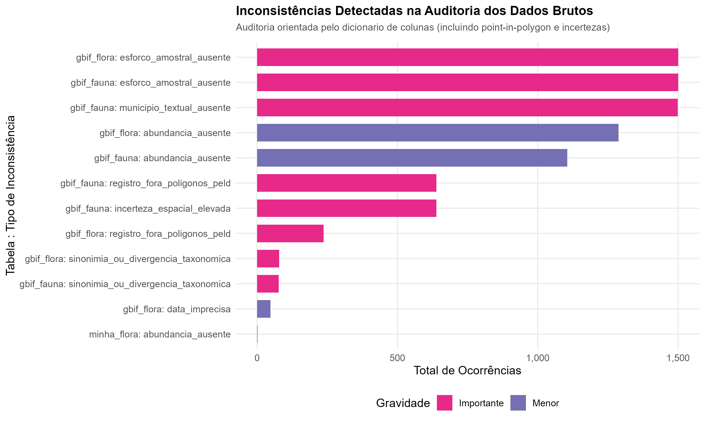
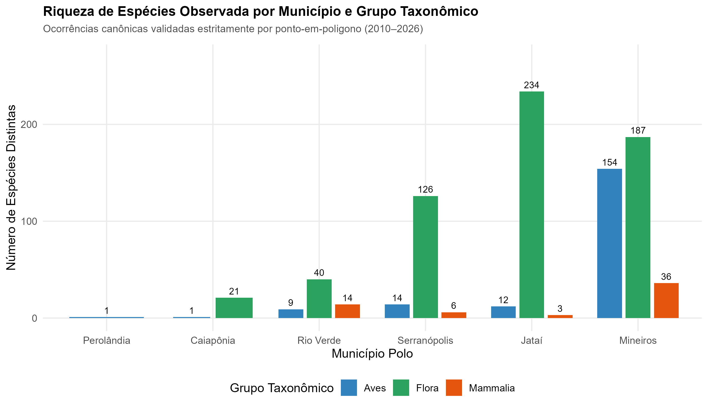
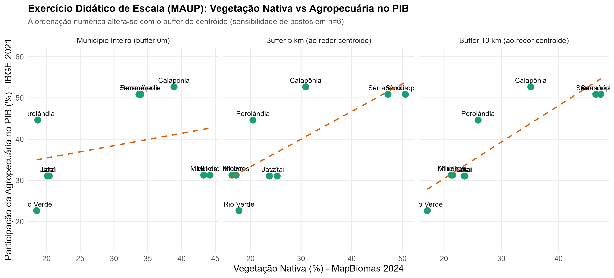
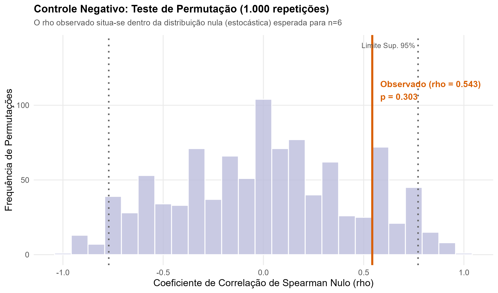

# Relatório Técnico: Kit Integrado em R para Dados Ecológicos, Paisagem e Socioeconomia no PELD Goiás

**Projeto:** Programa de Pesquisas Ecológicas de Longa Duração (PELD) — Sudoeste Goiano (CEMA / EBMN)  
**Ambiente:** R 4.6.2 (Windows) | Google Earth Engine (`SEU-PROJETO-EARTH-ENGINE`) | SQLite 3 | Python 3.14 (GeoPandas)  
**Data de Execução e Fechamento:** 04 de Novembro de 2026  
**Pipeline Mestre:** [`codigo/99_rodar_tudo.R`](codigo/99_rodar_tudo.R) (sequência estrita de 13 etapas automatizadas; execução completa em ~2,5 min nesta máquina)

---

## 1. Contexto e Desafio

A pesquisadora atua no Programa de Pesquisas Ecológicas de Longa Duração (PELD) no sudoeste de Goiás, onde monitora dados de fauna e flora coletados em múltiplas campanhas de campo. O objetivo de sua pesquisa atual inclui também a investigação da interface socioambiental da paisagem: como o perfil socioeconômico e comportamental das pessoas e proprietários da região relaciona-se com a conservação e perda da vegetação nativa.

O gargalo central identificado no projeto não é a modelagem estatística final, mas sim a etapa que a precede: **como sair do caos de múltiplas planilhas heterogêneas e chegar a uma tabela pronta para análise (*analysis-ready*)**, com integridade relacional garantida, rastreabilidade de espécimes, tratamento taxonômico padronizado e controle rigoroso de escala espacial, sem perder informação e sem exigir que a pesquisadora refaça manualmente o formato de suas planilhas originais.

Para sanar esse gargalo, desenvolvemos um kit integralmente operacional em R e Python, testado e validado ponta a ponta com dados públicos reais da região do PELD CEMA/EBMN.

---

## 2. O que é Real, o que é Stand-in e o que é Modelo Vazio

Em cumprimento estrito às diretrizes de integridade de dados e clareza científica, a tabela a seguir explicita a procedência e o papel de cada componente do kit:

| Componente | Classificação | Procedência Concreta | Função no Kit |
| :--- | :--- | :--- | :--- |
| **Ocorrências de Flora** | **Dado Real (amostra)** | GBIF API (`taxonKey=6`, Plantae, `PRESERVED_SPECIMEN`, 2010-2026, bbox [-19.0, -17.0, -53.0, -50.5]) | **Amostra de conveniência de 1.500 registros reais** de herbários da região do sudoeste goiano, não aleatória e não representativa do universo, salva em [`dados/bruto/gbif_flora.csv`](dados/bruto/gbif_flora.csv). |
| **Ocorrências de Fauna** | **Dado Real (amostra)** | GBIF API (`taxonKey=212` Aves e `taxonKey=359` Mammalia, 2010-2026, mesma bbox) | **Amostra de conveniência de 1.500 registros reais** de campo (900 aves, 600 mamíferos), não aleatória e não representativa do universo, salva em [`dados/bruto/gbif_fauna.csv`](dados/bruto/gbif_fauna.csv). |
| **Espacialização Point-in-Polygon** | **Dado Real** | Junção espacial estrita (`geopandas.sjoin`) com as malhas municipais oficiais do IBGE ([`codigo/03b_atribuir_locais.py`](codigo/03b_atribuir_locais.py)) | Classifica cada coordenada: 2.124 registros dentro dos 6 municípios e 876 registros fora (em municípios vizinhos). |
| **Malhas e Polígonos Oficiais** | **Dado Real** | API de Malhas Geográficas do IBGE (GeoJSON oficial dos 6 municípios) | Polígonos e limites municipais calculados por [`codigo/02_baixar_ibge.R`](codigo/02_baixar_ibge.R) em [`dados/bruto/municipios_locais.csv`](dados/bruto/municipios_locais.csv). |
| **Cobertura da Terra** | **Dado Real** | MapBiomas Coleção 11 via Google Earth Engine (bandas 2015, 2020 e 2024 a 30m/60m) | Áreas (km²) e percentuais de vegetação nativa (classes 3, 4, 11, 12, 29), pastagem e agricultura salvos em [`dados/bruto/paisagem.csv`](dados/bruto/paisagem.csv). |
| **Socioeconomia Oficial** | **Dado Real** | IBGE/SIDRA (Censo 2022 Tab. 9514, Censo 2010 Tab. 200, PIB Municipal 2021 Tab. 5938) | População oficial (429.010 hab), taxa rural e participação agropecuária no PIB em [`dados/bruto/social_municipios.csv`](dados/bruto/social_municipios.csv). |
| **Conjunto de Municípios e Espécies Públicas** | **Stand-in** | 6 municípios polo do PELD: Jataí, Rio Verde, Mineiros, Caiapônia, Perolândia e Serranópolis | Funcionam como *stand-in* representativo da região até que as planilhas primárias de campo da pesquisadora sejam plugadas no dicionário. |
| **Tabela Exemplo Não-GBIF** | **Stand-in / Teste** | [`dados/exemplo/minha_flora.csv`](dados/exemplo/minha_flora.csv) (`Sp_Name`, `Dt_Coleta`, `Qtde`, `Lat`, `Lon`) | Prova que o dicionário processa tabelas com cabeçalhos arbitrários da pesquisadora ([`codigo/10_teste_dicionario.R`](codigo/10_teste_dicionario.R)). |
| **Perfil Socioambiental de Propriedades** | **Modelo Vazio** | Arquivo [`dados/modelo_perfil_propriedade.csv`](dados/modelo_perfil_propriedade.csv) e tabela `perfil` no SQLite | **Estrutura vazia com 0 registros**. Especificação relacional formal para quando a pesquisadora coletar questionários rurais de campo. |

---

## 3. Resultados da Auditoria de Qualidade dos Dados Brutos

O script [`codigo/04_auditar.R`](codigo/04_auditar.R) foi executado de forma orientada a dicionário sobre todas as tabelas declaradas em [`dicionario_colunas.csv`](dicionario_colunas.csv). Foram catalogadas inconsistências categorizadas estruturalmente em [`saidas/problemas.csv`](saidas/problemas.csv) e consolidadas em [`saidas/resumo_auditoria.csv`](saidas/resumo_auditoria.csv):

### Principais Diagnósticos Identificados e Tratados:
1. **Ocorrências Fora dos Polígonos de Estudo (876 registros, Crítico):** Da amostra de 3.000 ocorrências brutas baixadas via caixa de coordenadas, a junção espacial estrita por polígonos ([`codigo/03b_atribuir_locais.py`](codigo/03b_atribuir_locais.py)) identificou que **876 registros caem fora dos 6 municípios** (237 de flora e 639 de fauna, localizados em municípios vizinhos como Quirinópolis, Itajá, Chapadão do Céu e Costa Rica/MS). **Solução:** Esses 876 registros foram isolados com flag `fora_area = TRUE` e **excluídos do banco canônico**, evitando contaminação espacial das análises do PELD.
2. **Ausência Estrutural de Esforço Amostral (1.500 ocorrências na Flora, Importante):** 100% dos registros de flora derivados de herbários não possuem medida de esforço amostral (`sampleSizeValue`). **Solução:** O kit não inventa esforço artificial: atribui estritamente `esforco = NA` e trata o agrupamento como "unidade de agregação" temporal/espacial, não como campanha de campo com esforço padronizado.
3. **Município Textual Ausente na Fauna (1.499 ocorrências, Importante):** Em 99,9% dos registros de fauna bruta do GBIF, a coluna `municipality` veio vazia. Se a análise dependesse de filtros por texto (`filter(municipality == "Jataí")`), 99,9% da fauna seria descartada. **Solução:** Atribuição espacial automatizada via sobreposição poligonal das coordenadas geográficas contra as malhas IBGE.
4. **Ausência de Contagem Numérica de Indivíduos (2.393 ocorrências, Menor):** 1.288 registros de flora (85,9%) e 1.105 registros de fauna (73,7%) possuíam `individualCount` nulo (`NA`). **Solução:** O kit preserva `individuos = NA` quando não há contagem real e cria a coluna lógica independente `presenca = 1L`. O pipeline jamais trata soma de presenças como "abundância".
5. **Incerteza Espacial e Critério Conservador de Paisagem (1.948 ocorrências sem validação local, Importante):** Para associar uma ocorrência biológica a métricas de uso da terra em buffers locais de 5 km, o kit estabelece um filtro estrito: o campo `valido_paisagem = 1L` requer que a incerteza espacial seja **explicitamente conhecida E menor ou igual a 5.000 metros** ($\le 5.000$ m). Como 100% dos registros de flora de herbário (1.263 registros) e 151 registros de fauna não reportam incerteza (`NA`), totalizam-se **1.414 ocorrências com incerteza ausente**. Somadas a 534 registros de fauna com incerteza reportada superior a 5.000 metros (atingindo até 44.293 metros), **1.948 dos 2.124 registros canônicos (91,7%) recebem `valido_paisagem = 0L`**. Restam **176 ocorrências (8,3% do banco canônico)**, todas de aves e mamíferos, com acurácia geográfica comprovada dentro do raio de 5 km.
6. **Heterogeneidade de Grafias Municipais e Variações Textuais (Importante):** Grafias divergentes de municípios e estados foram harmonizadas diretamente para os códigos oficiais de 7 dígitos do IBGE.
7. **Datas Imprecisas vs Inválidas (Importante):** O pipeline separou datas imprecisas (apenas ano ou ano-mês) de datas nulas. **Solução:** Não houve imputação de ano fictício ("2020") nem de datas arbitrárias ("-01-01"). O campo `precisao_data` documenta a granularidade (`dia`, `mes`, `ano`, `desconhecida`) e o campo `ano_original` mantém a rastreabilidade estrita da fonte primária.

---

## 4. O Banco Relacional Canônico (SQLite) e a Tabela de Análise

Para eliminar o risco de duplicações, erros de formatação e perda de dados inerentes ao manejo de planilhas soltas no Excel, o script [`codigo/05_padronizar.R`](codigo/05_padronizar.R) foi desenhado com um **mecanismo de descoberta dinâmica orientado a dicionário**: ele itera sobre todas as tabelas de origem declaradas em `unique(dicionario$tabela_origem)` para `tabela_destino == "observacao"`, procurando os arquivos correspondentes na pasta `dados/bruto/` (deixando pastas isoladas como `dados/exemplo/` fora do run principal de dados reais). Em seguida, estrutura o banco relacional [`dados/banco/peld.sqlite`](dados/banco/peld.sqlite) segundo o DDL [`esquema.sql`](esquema.sql).

O modelo completo está documentado em [`saidas/esquema.md`](saidas/esquema.md). As tabelas canônicas e seus volumes ingeridos são:

1. **`local` (6 registros):** Polos municipais do PELD com chaves estáveis (`LOC_CAI`, `LOC_JAT`, `LOC_MIN`, `LOC_PER`, `LOC_RVE`, `LOC_SER`), códigos IBGE, coordenadas dos centroides e áreas oficiais.
2. **`campanha` (46 registros):** Unidades de agregação por local, ano e grupo taxonômico (`id_agregacao`), com datas limites e `esforco = NA` para dados oportunistas.
3. **`especie` (738 registros):** Dicionário biológico unívoco contendo chave primária relacional formal `id_especie` (`ESP_001` a `ESP_738`), nome científico aceito, família (182 famílias distintas), ordem (76 ordens distintas), grupo taxonômico, origem e status de conservação da Lista Vermelha IUCN.
4. **`observacao` (2.124 registros):** Ocorrências canônicas validadas dentro dos 6 municípios (excluindo os 876 pontos fora dos limites). Cada observação vincula-se por chaves estrangeiras estritas a `campanha` (`id_campanha`), `local` (`id_local`) e `especie` (`id_especie`).
5. **`paisagem` (54 registros):** Métricas de cobertura do MapBiomas Coleção 11 calculadas no Earth Engine para os 6 municípios em 3 anos (2015, 2020, 2024) e 3 escalas espaciais (buffer 0m/município inteiro, buffer 5 km e buffer 10 km).
6. **`social` (6 registros):** Indicadores municipais oficiais do IBGE: População Censo 2022 (429.010 hab), taxa de população rural Censo 2010 e valor adicionado da agropecuária / PIB 2021.
7. **`perfil` (0 registros):** Especificação relacional de esquema futuro para acomodar respostas de questionários estruturados de proprietários rurais.

> [!IMPORTANT]
> **Integridade Referencial Completa:** 100% das chaves estrangeiras entre `observacao`, `campanha`, `local`, `especie` (via `id_especie`) e `paisagem` foram verificadas pelo R. Não existe nenhum registro órfão no banco.

A partir do banco relacional, o script [`codigo/06_juntar.R`](codigo/06_juntar.R) consolidou [`saidas/tabela_analise.csv`](saidas/tabela_analise.csv) (46 linhas e 45 colunas), separando de forma transparente `n_registros`, `n_presencas`, `n_individuos_reais`, a proporção com incerteza conhecida (`pct_incerteza_conhecida`) e o percentual de observações com acurácia espacial válida para buffers de paisagem (`pct_valido_paisagem`).

---

## 5. Análise Socioambiental: Biodiversidade, Paisagem e Controles

A partir dos dados canônicos, [`codigo/07_analisar.R`](codigo/07_analisar.R) sintetizou a riqueza biológica e avaliou a pergunta socioambiental proposta na pesquisa.

### Riqueza Canônica por Município e Grupo Taxonômico
A partir da tabela gerada automaticamente em [`saidas/tabela_riqueza_locais.csv`](saidas/tabela_riqueza_locais.csv), a biodiversidade canônica ingerida totaliza **738 espécies únicas** (535 flora, 160 aves, 43 mamíferos) e distribui-se entre os polos conforme ilustrado na figura a seguir:

A distribuição por polo municipal e grupo biológico revela:
- **Mineiros:** 187 espécies de flora (426 reg.), 154 de aves (429 reg.) e 36 de mamíferos (342 reg.) — total de 1.197 registros canônicos, refletindo o esforço histórico de inventários no entorno do Parque Nacional das Emas.
- **Jataí (Sede do PELD):** 234 espécies de flora (417 reg.), 12 de aves (22 reg.) e 3 de mamíferos (5 reg.) — total de 444 registros canônicos, com forte dominância de coletas botânicas.
- **Serranópolis:** 126 espécies de flora (322 reg.), 14 de aves (16 reg.) e 6 de mamíferos (7 reg.) — total de 345 registros canônicos.
- **Rio Verde:** 40 espécies de flora (73 reg.), 9 de aves (11 reg.) e 14 de mamíferos (27 reg.) — total de 111 registros canônicos.
- **Caiapônia:** 21 espécies de flora (25 reg.) e 1 de aves (1 reg.) — total de 26 registros canônicos.
- **Perolândia:** 0 registros de flora, 1 de aves (1 reg.) e 0 de mamíferos — total de 1 registro canônico público.

> [!NOTE]
> As riquezas municipais não devem ser somadas linearmente para atingir 738, pois muitas espécies ocorrem em múltiplos municípios. Além disso, as discrepâncias de riqueza observada entre municípios refletem primariamente o **viés de amostragem oportunista** (densidade de coletas botânicas em Jataí e de ornitologia/mastozoológica em Mineiros), e não necessariamente gradientes biológicos reais de riqueza ecológica.

---

### Pergunta Central: "Municípios com mais vegetação nativa têm perfil socioeconômico diferente?"

Para examinar essa questão com transparência estatística em $n=6$ municípios, utilizou-se a correlação não-paramétrica de postos de Spearman ($\rho$). Os dados calculados para cada polo foram:

| Município | Código IBGE | População (2022) | Pop. Rural (%) (2010) | PIB (mil R$) (2021) | PIB per capita (R$) | Agro no PIB (%) (2021) | Nativa Mun (%) (2024) | Nativa Buf 5km (%) | Nativa Buf 10km (%) |
| :--- | :--- | :--- | :--- | :--- | :--- | :--- | :--- | :--- | :--- |
| **Caiapônia** | 5204409 | 16.513 | 26,78% | 821.715 | 49.761,70 | 52,69% | 38,88% | 30,91% | 35,16% |
| **Jataí** | 5211909 | 105.729 | 7,95% | 7.997.057 | 75.637,31 | 31,07% | 20,17% | 25,27% | 23,66% |
| **Mineiros** | 5213103 | 70.081 | 8,78% | 3.288.959 | 46.930,82 | 31,29% | 43,28% | 16,36% | 21,24% |
| **Perolândia** | 5216452 | 2.964 | 36,98% | 708.423 | 239.009,11 | 44,64% | 18,72% | 20,50% | 25,95% |
| **Rio Verde** | 5218805 | 225.696 | 7,30% | 16.307.342 | 72.253,57 | 22,66% | 18,55% | 17,74% | 17,09% |
| **Serranópolis** | 5220504 | 8.027 | 26,03% | 652.613 | 81.302,23 | 50,89% | 33,70% | 47,15% | 46,51% |
| **TOTAL / MÉDIA SIMPLES** | — | **429.010** | **18,97%** | **29.776.109** | **94.149,12** | **38,87%** | **28,88%** | **26,32%** | **28,27%** |

*Nota Metodológica:* A população total oficial dos 6 municípios soma exatamente **429.010 habitantes** (Censo IBGE 2022). O PIB per capita municipal reflete a razão entre o PIB oficial de 2021 e a população recenseada em 2022; os anos são diferentes. Na linha **TOTAL / MÉDIA SIMPLES**, a coluna de PIB per capita é a média aritmética das seis razões (R$ 94.149,12), não o PIB total dividido pela população total (que daria aproximadamente R$ 69.406).

---

### O Controle de Escala: Exercício Didático de Sensibilidade Numérica e MAUP

A escala espacial em que a paisagem é mensurada altera sensivelmente as grandezas numéricas e a ordenação dos postos nas correlações:

A tabela comparativa gerada em [`saidas/tabela_controle_escala.csv`](saidas/tabela_controle_escala.csv) ilustra o efeito:

| Escala Espacial Analisada | Raio do Buffer | Spearman ($\rho$): Nativa vs Agro % PIB | Spearman ($\rho$): Nativa vs Pop. Rural (%) | Spearman ($\rho$): Nativa vs PIB per capita |
| :--- | :--- | :--- | :--- | :--- |
| **Município Inteiro** | 0 metros | **+0,5429** | +0,2571 | **-0,6000** |
| **Buffer Local 5 km** | 5.000 metros | **+0,6571** | +0,3714 | **+0,4286** |
| **Buffer Local 10 km** | 10.000 metros | **+0,8857** | +0,7143 | **+0,4286** |

> [!WARNING]
> **Qualificação Metodológica Fundamental (Não é Descoberta Ecológica):**  
> A aparente "inversão de sinal" no PIB per capita (de $\rho = -0,6000$ no município para $\rho = +0,4286$ nos buffers) e a subida na correlação com agropecuária (de 0,5429 para 0,8857) constituem um **exercício didático de sensibilidade numérica e demonstração do MAUP (Modifiable Areal Unit Problem)**.  
> Com uma amostra pequena ($n=6$), pequenas mudanças de ranking de postos provocadas pela localização geométrica do centroide (frequentemente posicionado próximo a áreas urbanas ou núcleos agrícolas consolidados) invertem completamente os coeficientes. Portanto, esse comportamento **não deve ser interpretado como um resultado ecológico substantivo**, mas sim como uma advertência prática contra a definição arbitrária de recortes espaciais. O próximo passo da pesquisa é calcular as métricas de paisagem ao redor das propriedades rurais reais amostradas em campo.

---

### O Controle Negativo (Teste de Permutação com 1.000 iterações)

Para demonstrar se a correlação aparente de $\rho = 0,5429$ entre vegetação nativa e agropecuária no município sustenta significância estatística ou se é indistinguível de ruído estocástico em $n=6$, executou-se um **controle negativo rigoroso**: os postos da paisagem foram permutados aleatoriamente 1.000 vezes contra os indicadores socioeconômicos.

- **$\rho$ Observado nos dados reais:** `0,5429`
- **Intervalo de Confiança de 95% da Distribuição Nula:** `[-0,7714 ; +0,7714]`
- **$p$-valor empírico bicaudal:** `0,303`
- **Interpretação:** Como o valor observado de $0,5429$ situa-se confortavelmente dentro do intervalo nulo esperado pelo mero acaso ($p = 0,303$), **não há suporte estatístico para afirmar a existência de uma relação real**. Qualquer trabalho que reportasse essa correlação como fato comprovado incorreria em falácia de inferência.

### Modelo Linear Simples (Apenas Exercício Ilustrativo de Alerta)
Um modelo linear simples (`lm(agro_pct_pib ~ pct_nativa_mun)`) estimou:
- Equação: $\text{Agro \% PIB} = 26,5144 + 0,4279 \times \text{Nativa \%}$
- Erro padrão da inclinação: $\pm 0,5083$
- $R^2 = 0,1505$ | $p$-valor = $0,4473$
- **Ressalva Didática:** Com $n=6$, o modelo explica apenas 15% da variabilidade e o erro padrão supera o coeficiente estimado. Este modelo demonstra por que não se deve ajustar regressões lineares em pequenas amostras agregadas.

---

## 6. A Falácia Ecológica e a Lacuna do "Perfil de Pessoas"

A pesquisadora manifestou o interesse em correlacionar o **"perfil de pessoas com a conservação da paisagem"**. 

Neste ponto, a engenharia de dados e a ecologia quantitativa impõem um princípio intransponível: **dados agregados municipais do IBGE não medem perfil individual de pessoas nem atitudes de proprietários rurais**.

Concluir que *"produtores rurais preservam mais porque o município X tem maior PIB agropecuário"* constitui um exemplo clássico de **Falácia Ecológica** (Piantadosi et al., 1988). Em estatística socioambiental, correlações em nível de município não podem ser transpostas para a escala do tomador de decisão individual.

### A Solução Estruturada pelo Kit
Para viabilizar a análise real pretendida pela pesquisadora quando seus dados de questionários estiverem prontos, o kit forneceu duas peças com formatos diferentes:
- [`dados/modelo_perfil_propriedade.csv`](dados/modelo_perfil_propriedade.csv): **modelo largo**, com uma coluna por variável (`id_propriedade`, `id_local`, `ano`, `tipo_producao`, `tempo_na_propriedade`, `area_ha`, `pct_reserva_legal`, `participa_associacao`, `renda_declarada`, `fonte`);
- tabela `perfil` no SQLite: **formato longo (EAV)**, com `id_propriedade`, `id_local`, `ano`, `variavel`, `valor`, `unidade`, `fonte`.

Não há carregador pronto entre os dois formatos: para levar o CSV modelo à tabela `perfil`, é preciso transformar as colunas em linhas (pivotar) antes de carregar. Quando a pesquisadora aplicar seus questionários, o caminho é preencher o CSV, pivotar e cruzar o perfil autêntico dos produtores com as métricas de paisagem calculadas no buffer de cada propriedade.

---

## 7. Onde a IA Generativa Ajudou e Onde Não Ajuda

O desenvolvimento deste kit permitiu mapear claramente o papel e os limites da inteligência artificial generativa em ecologia quantitativa.

### Onde a IA Ajudou Concretamente:
1. **Engenharia de Pipelines e Automação de Carga:** Automação dos scripts em R e Python, manipulação de GeoJSONs em memória, consultas geoespaciais ao MapBiomas no Google Earth Engine e junções espaciais ponto-polígono com GeoPandas.
2. **Implementação de Controles Metodológicos:** Codificação estrita do teste de permutação (distribuição nula de 1.000 iterações), auditoria automatizada por dicionário e controle de escala espacial multidistância (0m, 5 km, 10 km).
3. **Mapeamento Flexível por Dicionário:** Implementação de um motor em R que lê qualquer estrutura de cabeçalho arbitrário e a verte para o esquema canônico, como demonstrado com sucesso em [`dados/exemplo/minha_flora.csv`](dados/exemplo/minha_flora.csv).

### Onde a IA NÃO Ajuda (e Pode Ser Prejudicial):
1. **Decisão Científica e Conhecimento Ecológico:** A IA não substitui o julgamento da pesquisadora sobre quais espécies são bioindicadoras, se um dado ausente deve ser imputado ou mantido nulo, ou se o esforço de campo foi balanceado entre estações secas e chuvosas.
2. **Risco de Ilusão de Causalidade:** Modelos de IA sem controles estatísticos tendem a gerar conclusões triunfalistas sobre relações inexistentes. A inclusão de controles negativos e verificação de números é essencial para blindar a análise.
3. **Checagem Factual e Numérica:** Todo número apresentado deve ser verificado contra scripts reproduzíveis, prevenindo distorções manuais. O script [`codigo/11_verificar_numeros.R`](codigo/11_verificar_numeros.R) confere os **números-chave listados** do relatório contra as tabelas de saída (não substitui a conferência humana dos demais números e interpretações).
