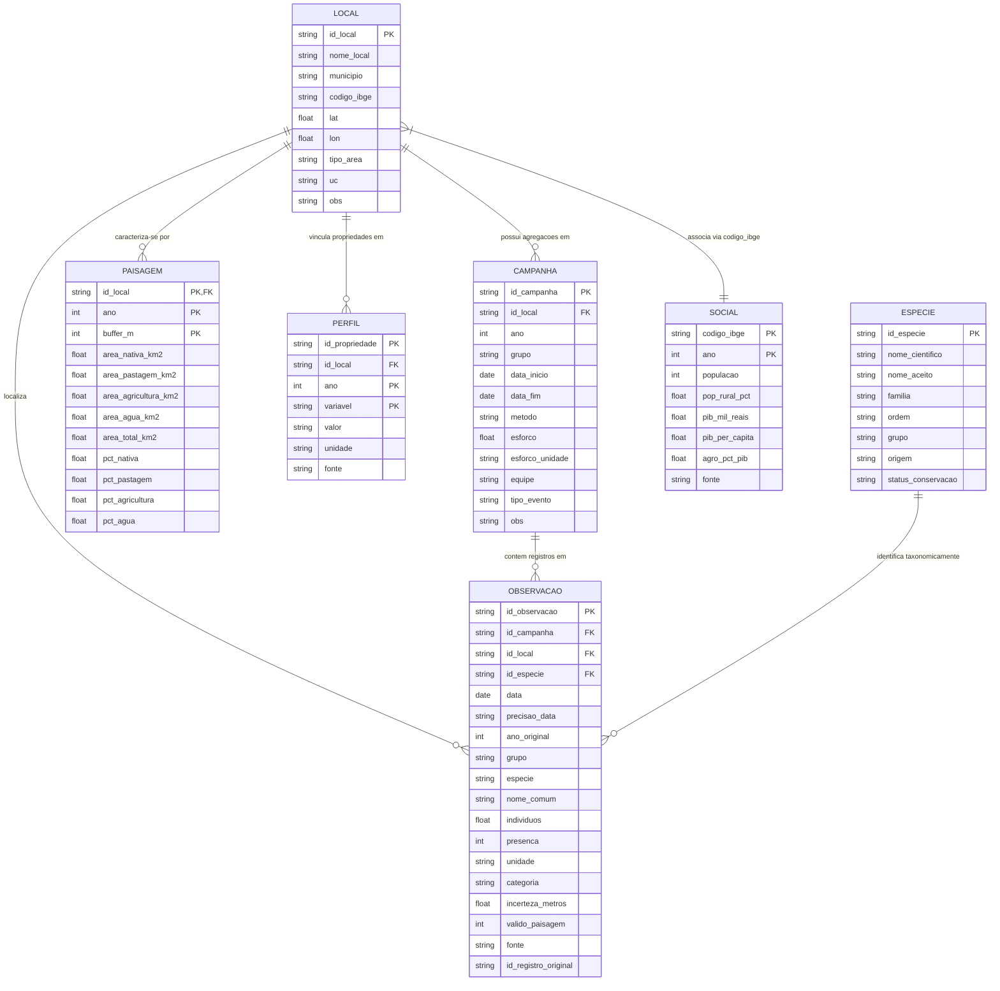

# Esquema Relacional do Banco de Dados Ecológico PELD

Diagrama entidade-relacionamento (ER) do banco de dados relacional implementado em SQLite (`dados/banco/peld.sqlite`) e exportado em CSVs canônicos.

## Descrição das Tabelas e Relações

1. **`local`**: Unidade espacial de amostragem (município polo do PELD). Chave primária `id_local`.
2. **`campanha`**: Unidade de agregação temporal-espacial (`id_campanha`), agrupando coletas de mesmo polo, ano e grupo taxonômico. Para dados oportunistas, `esforco = NA` e `esforco_unidade = NA`.
3. **`observacao`**: Tabela longa e atômica (`id_observacao`). Contém registros canônicos validados por ponto-em-polígono. Contém colunas explícitas `presenca = 1L`, `precisao_data` e `valido_paisagem`.
4. **`especie`**: Dicionário taxonômico de referência (`nome_cientifico`), padronizado com `acceptedScientificName`.
5. **`paisagem`**: Métricas de cobertura e uso da terra do MapBiomas Coleção 11 calculadas no Earth Engine (município e buffers de 5 km e 10 km).
6. **`social`**: Indicadores socioeconômicos municipais agregados (Censo 2022, Censo 2010 e PIB 2021 do IBGE/SIDRA).
7. **`perfil`**: Modelo em formato entidade-atributo-valor (EAV) para variáveis de produtores rurais e entrevistas de campo (especificação de modelo vazio).
